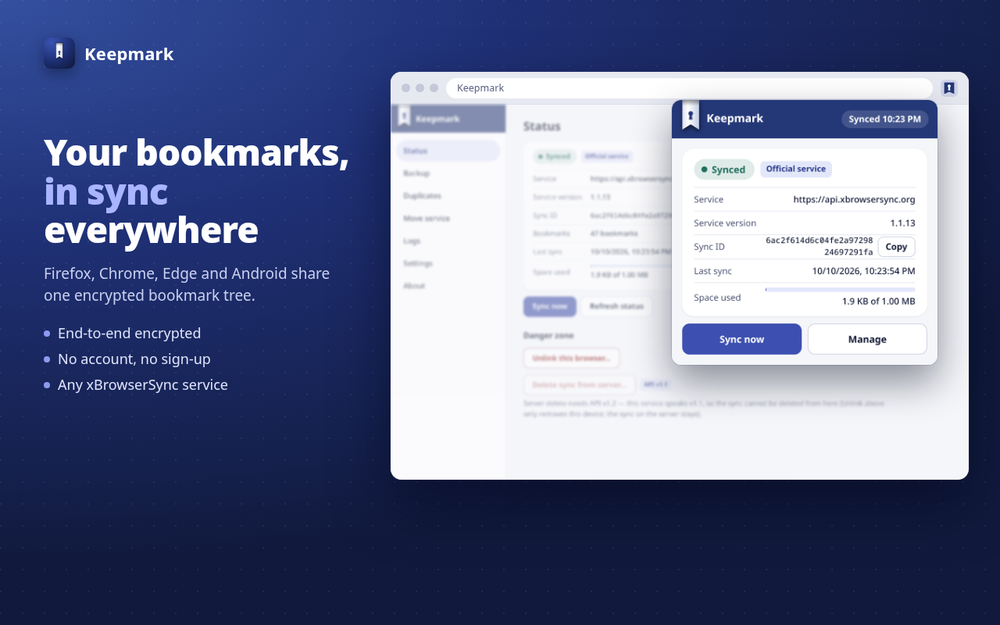
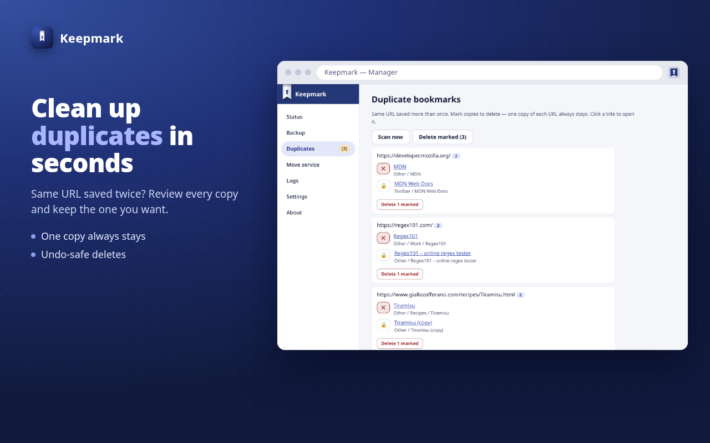
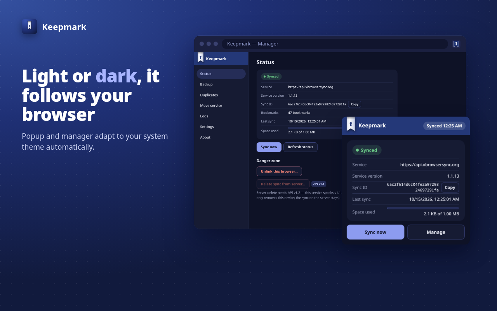

<p align="center">
  
</p>

<h1 align="center">Keepmark for browsers</h1>

<p align="center">
  <b>Your bookmarks in every browser, synced and end-to-end encrypted.</b><br />
  An independent extension compatible with xBrowserSync.
</p>

<p align="center">
  
  <a href="https://chromewebstore.google.com/detail/jaaekkbgpeiikepahjelfbkfgpjphbhb"></a>
  
  
  
</p>

<p align="center">
  
</p>

---

Keepmark keeps the same bookmarks on all your browsers and your phone.
Everything is encrypted in the browser before it leaves: the service that
stores your data sees only ciphertext, and your password never leaves the
device.

It works with **any xBrowserSync service** (the official one, a community
host or your own) and with the official xBrowserSync apps. A sync created in
Keepmark opens there, and the other way round. Nothing to migrate.

## Highlights

- **Private by design.** PBKDF2-SHA256 and AES-GCM in the browser. No
  telemetry, HTTPS-only services, and no access to the pages you visit.
- **Never lose a bookmark silently.** Conflicts are never resolved behind
  your back: you pick take remote, upload local or merge, and merge shows a
  preview of the counts before anything changes. The side being replaced is
  backed up first.
- **Set and forget.** Toolbar, menu and other bookmarks sync automatically,
  with a periodic check for changes made elsewhere and a "Sync now" button.
- **Fits your browser.** The toolbar icon follows the light or dark theme
  and shows at a glance whether you are in sync.

## Features

| | |
|---|---|
| **Connect** | Create a new sync or link an existing one: download, upload or merge with preview |
| **Sync** | Automatic sync of toolbar, menu and other bookmarks, plus "Sync now" |
| **Safety backups** | Automatic encrypted snapshot before every destructive step (newest 5 kept) |
| **Backup** | Encrypted export and import, compatible with Keepmark for Android |
| **Duplicates** | Find links saved more than once, delete one by one or in bulk; the last copy is always kept |
| **Move service** | Move your bookmarks to another service, into a new or existing sync |
| **Account** | Change password, activity log, clear error messages at every step, undo for quick actions |
| **Languages** | English, Italiano, Français, Español, Deutsch, 日本語, Português (Brasil), Русский, 简体中文; follows the browser, override in Settings |

With **Keepmark Server** you also get revision-based conflict detection,
faster "nothing changed" checks and the option to delete your sync from the
server. On other services Keepmark falls back automatically.

## Screenshots

<p align="center">
  
  
</p>

<p align="center">
  
  
</p>

<p align="center">
  
</p>

## The Keepmark family

| | |
|---|---|
| **Keepmark for browsers** | This extension (Firefox, Chrome, Edge, Brave) |
| **Keepmark for Android** | Android 10+ app with search, share-to-Keepmark and app lock |
| **Keepmark Server** | Drop-in xBrowserSync-compatible sync service with opt-in extended features |

All three share the same encryption, the same backup format and the same
wording, so moving between them feels the same.

## Compatibility

- **Browsers:** Firefox (Manifest V2) and Chromium-based browsers such as
  Chrome, Edge and Brave (Manifest V3, Chrome 109 or later).
- **Services:** any xBrowserSync API service, version 1.1.9 or later.
- **Clients:** syncs open both ways with the official xBrowserSync apps
  (sync format 1.8.0). The encryption is verified byte for byte against the
  official implementation.

## Permissions

Keepmark asks only for what sync needs: bookmarks, storage, alarms (periodic
checks), notifications (conflicts, sync removed) and downloads (backup
files). On Chromium it also needs network access to reach the service you
choose. There are no content scripts: Keepmark never reads web pages.
Details per permission: [developer guide](docs/DEVELOPMENT.md#permissions-why-each-one).

## Get it

- **Chrome, Edge, Brave:** install from the
  [Chrome Web Store](https://chromewebstore.google.com/detail/jaaekkbgpeiikepahjelfbkfgpjphbhb).
- **Firefox:** coming soon on addons.mozilla.org. Meanwhile the
  Mozilla-signed `.xpi` is in the
  [latest release](https://github.com/Keepmark/KeepmarkApp/releases/latest).

Every [release](https://github.com/Keepmark/KeepmarkApp/releases) also
carries the Chromium `.zip`, the same package uploaded to the Chrome Web
Store.

Project home: <https://github.com/Keepmark>.

## Build from source

Requirements: Node.js 22 (LTS) with npm, and `zip` or `python3` for
packaging. Run everything from the repository root.

```sh
npm ci               # install the locked dependencies
npm test             # unit and UI tests (Vitest, no browser needed)
npm run lint         # type-check both targets
```

Build one browser or both:

```sh
npm run build:firefox    # build/firefox  (Manifest V2)
npm run build:chromium   # build/chromium (Manifest V3)
npm run build            # both
```

Package for the stores (builds both, then zips them):

```sh
npm run package      # dist/keepmark-firefox-<version>.zip
                     # dist/keepmark-chromium-<version>.zip
```

`<version>` comes from `package.json`. The packaging step refuses a build
whose manifest version differs from it.

Load an unpacked build for testing:

- **Firefox:** `about:debugging` → This Firefox → Load Temporary Add-on →
  `build/firefox/manifest.json`. A temporary add-on is removed when Firefox
  closes; for a permanent install use the signed `.xpi` from the
  [latest release](https://github.com/Keepmark/KeepmarkApp/releases/latest).
- **Chrome / Edge / Brave:** `chrome://extensions` → Developer mode → Load
  unpacked → `build/chromium`.

## Documentation

- [Developer guide](docs/DEVELOPMENT.md): stack, interop contract, layout,
  sync model, safety backups, platform differences.
- [Product and verification spec](docs/SPEC.en.md) ([italiano](docs/SPEC.md)).
- [Workflows](docs/WORKFLOWS.md) and [UI terms](docs/UI-TERMS.md): shared
  with Keepmark for Android.
- [Contributing](CONTRIBUTING.md).

## Feedback

Questions, bug reports and ideas: [open an issue](../../issues).

## License

Copyright (C) 2026 Yari Melzani. Free software: you can redistribute it
and/or modify it under the terms of the **GNU General Public License,
version 3 only** (GPL-3.0-only) — see [`LICENSE.md`](LICENSE.md).
Distributed without any warranty.

Contributions require signing the [CLA](CLA.md) — see
[`CONTRIBUTING.md`](CONTRIBUTING.md).

Independent implementation, written from scratch; compatible with the
xBrowserSync protocol. Not affiliated with or endorsed by xBrowserSync.
Third-party notices: `lzutf8` (MIT, © Rotem Dan), `webextension-polyfill`
(MPL-2.0).

## Disclaimer

Keepmark is provided "as is", without warranty of any kind, express or
implied, including the implied warranties of merchantability and fitness for
a particular purpose. Use it at your own risk: the authors are not liable for
any loss of data (including bookmarks), damage or other consequences arising
from its use. See sections 15–17 of the GPL v3. Keep your own backups.
