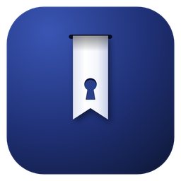
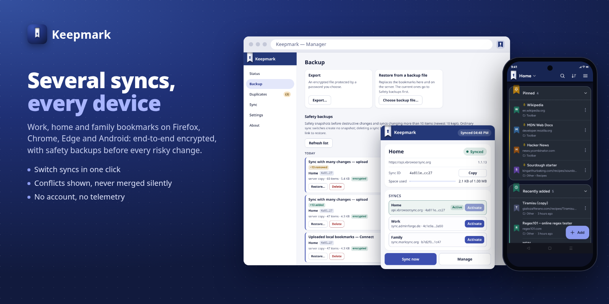
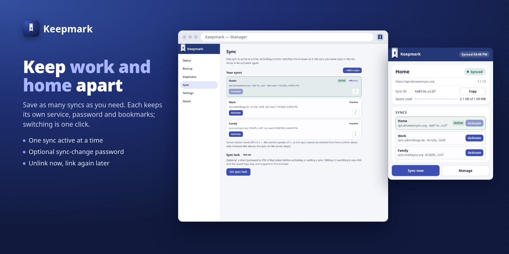
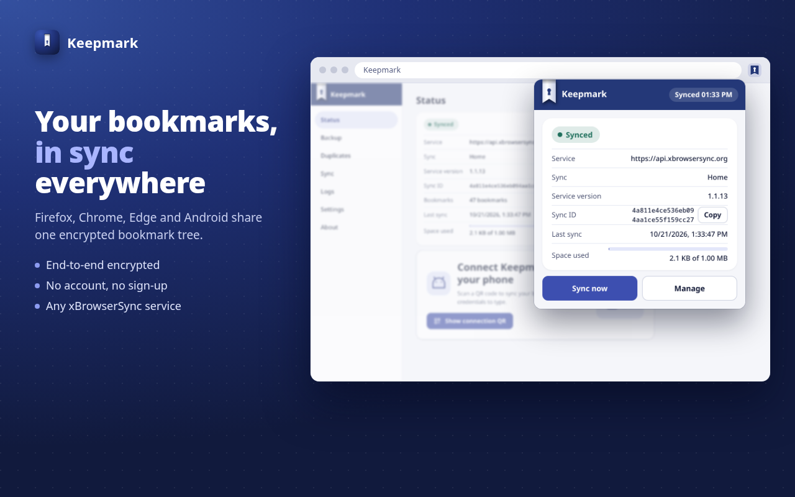
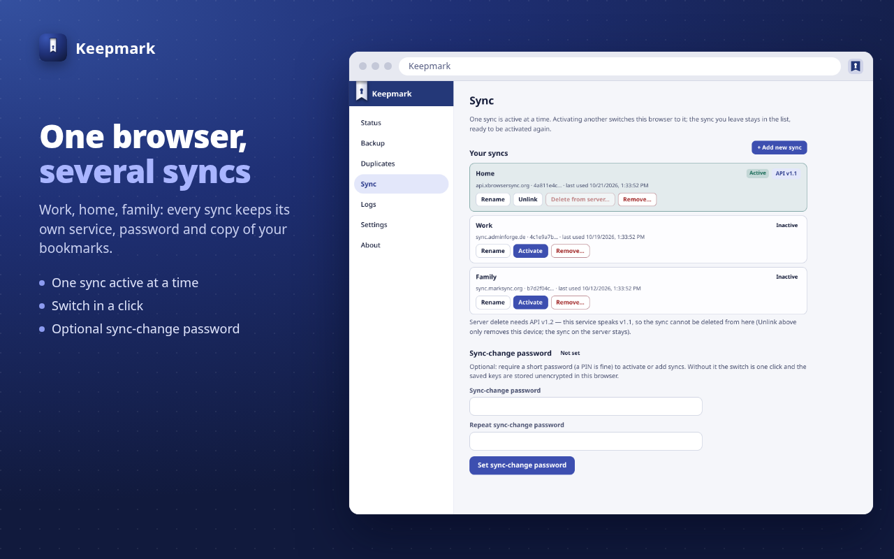
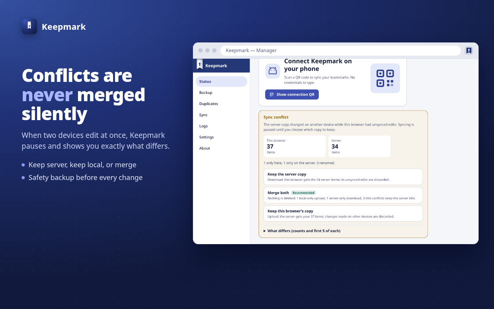
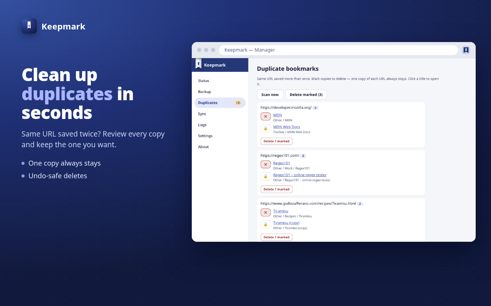
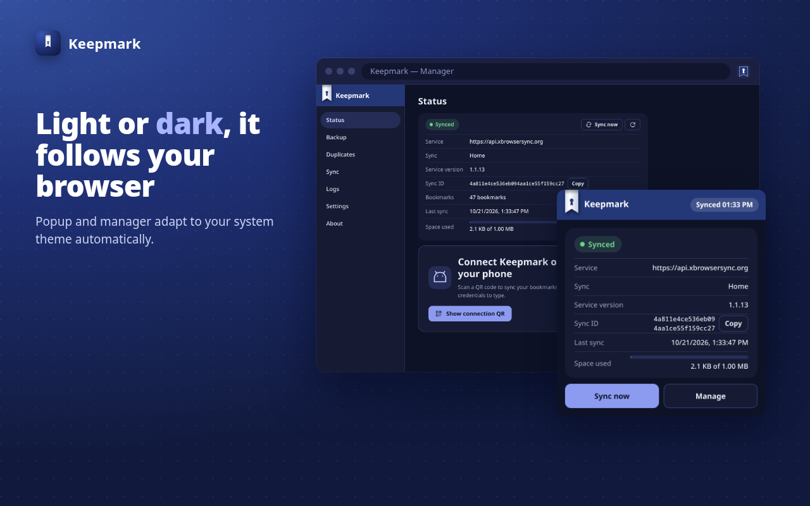
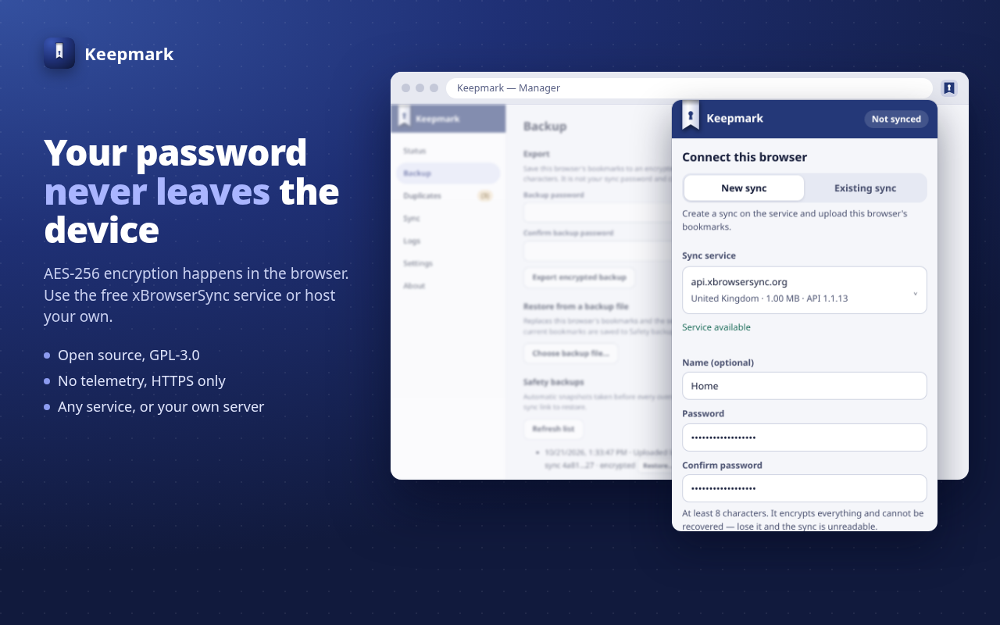
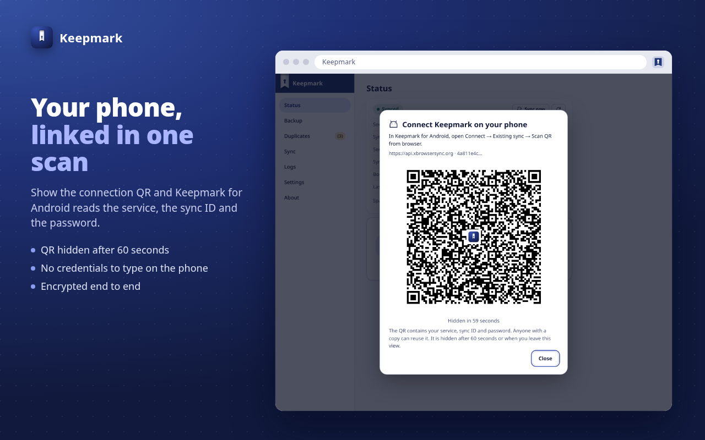

<p align="center">
  
</p>

<h1 align="center">Keepmark for browsers</h1>

<p align="center">
  <b>All your bookmark syncs in one browser: work, home, family.</b><br />
  Switch in a click, end-to-end encrypted, and nothing is ever lost silently.
</p>

<p align="center">
  <a href="https://addons.mozilla.org/en-US/firefox/addon/keepmark/"></a>
  <a href="https://chromewebstore.google.com/detail/jaaekkbgpeiikepahjelfbkfgpjphbhb"></a>
  
  
  
</p>

<p align="center">
  
</p>

---

Keepmark keeps your bookmarks in sync across browsers and your phone, and
lets one browser hold **several independent syncs**. Work, home, a shared
family collection, a test server: each keeps its own password and its own
bookmarks, and you move between them in a click. Everything is encrypted
before it leaves the browser, and every risky change leaves a way back.

## Why Keepmark

- **Multi-sync, built in.** Several syncs saved side by side, exactly one
  active, switched from the popup or the manager. The sync you leave is saved
  first; a conflict or failed save stops the switch instead of losing edits.
- **Private by design.** PBKDF2-SHA256 and AES-GCM run in the browser: the
  server stores ciphertext only and never sees your password. No telemetry,
  HTTPS-only services, no access to the pages you visit.
- **Fault tolerant.** Before anything replaces your bookmarks Keepmark keeps
  an encrypted safety backup, labelled with the sync it belongs to and how
  many items changed. Conflicts are never resolved behind your back, and a
  sync that disappears from its server leaves you a copy.
- **One scan to your phone.** The manager shows a connection QR; Keepmark for
  Android reads it and links the same sync without typing anything.

## Several syncs, one active

A browser is not limited to one sync. Keep **work and home apart**, keep a
shared **family** sync with its own password, or try a different server
without losing the one you use: every sync is saved with its own service,
password and bookmarks, exactly one is active, and switching is a click.



- **Add a sync** from the manager: create it on the target service, or open
  one you already use elsewhere. A new sync starts from the bookmarks in this
  browser; an existing one opens with a reviewed choice (keep the server copy,
  keep this copy, or merge). The sync you were using stays in the list.
- **Switch** from the popup or the manager. The sync you leave is saved
  before its bookmarks are replaced; a conflict or failed save blocks the switch.
  The target is verified on its server copy. Ordinary saved-sync activation
  creates no extra safety backup: the outgoing sync stays on its own server. An
  optional short **sync lock password** (a PIN is fine) can gate adding and
  switching, without ever asking again for the syncs' own long passwords.
- **A clean list.** Each saved sync shows **Activate** first; rarer commands
  (rename, Show QR, change password) sit in the row's **⋮** menu,
  with unlinking and server deletion kept apart at the bottom.
- **Stay in control**: unlink a sync (the server copy stays untouched), link
  it again later with its sync ID and password, or delete it from the server
  when the service supports it.
- **One phone, any sync**: use **Show QR** on any saved sync row to link
  the Android app without activating that sync in the browser.

## Never lose a bookmark silently

- **Safety backups.** Before a destructive change (taking the server copy,
  restoring a backup, cleaning duplicates, changing password) and before any
  sync that changes more than 10 items, Keepmark stores an encrypted snapshot
  of the side being replaced. The newest 10 are kept, listed by day with the
  operation in plain words, the sync's name, and how many items were added or
  removed. Restore is one click.
- **Conflicts are a choice, not a guess.** When two devices changed the same
  sync you pick keep the server copy, keep this copy, or merge, and merge shows
  the counts before anything changes.
- **Safe switching.** Pending edits are saved before another sync is
  activated; if that save fails, nothing is replaced.
- **Removed syncs leave a copy.** If a service no longer has your sync
  (expired or deleted elsewhere), Keepmark says so and keeps the last copy so
  you can restore or download it.
- **Atomic writes on Keepmark Server.** Revision-based compare-and-swap means
  two devices pushing at once can never silently overwrite each other.
- **Encrypted backups you own.** Export a password-protected file at any time
  and restore it here or on Android.

## Everyday comfort

- **Set and forget.** Toolbar, menu and other bookmarks sync automatically,
  with a periodic check for changes made elsewhere and a "Sync now" button.
- **Duplicates cleanup.** Find links saved more than once and remove them;
  the last copy always stays.
- **Fits your browser.** The toolbar icon follows the light or dark theme
  and shows at a glance whether you are in sync. Ten languages.

## Features

| | |
|---|---|
| **Connect** | Create a new sync or link an existing one: download, upload or merge with preview |
| **Link a phone** | Connection QR from the manager, scanned by Keepmark for Android: service, sync ID and password in one step |
| **Choose a service** | Eight public services with country, size limit and API version, plus the custom URLs that worked before |
| **Sync** | Automatic sync of toolbar, menu and other bookmarks, plus "Sync now" |
| **Safety backups** | Encrypted snapshot before destructive changes or syncs changing more than 10 items (newest 10 kept), grouped by day with sync name and added/removed counts; ordinary switches create none, deliberate server deletion keeps no copy |
| **Backup** | Encrypted export and import in two compact actions, compatible with Keepmark for Android; the verified review is the only confirmation |
| **Duplicates** | Find links saved more than once, delete one by one or in bulk; the last copy is always kept |
| **Syncs** | Several syncs saved side by side, one active at a time: switch from the popup or the manager, optionally behind a sync lock; rename, unlink (link it again later with its sync ID and password), delete from the server |
| **Add a sync** | Create a new sync on another service or open one you already use, with one reviewed confirmation; the sync you were using stays saved |
| **Controls** | Change password on the active sync row; activity log in Settings; recovery in Backup → Safety backups |
| **Languages** | English, Italiano, Français, Español, Deutsch, 日本語, Português (Brasil), Română, Русский, 简体中文; follows the browser, override in Settings |

## Link Android by QR

Already syncing on Android and want the phone on the same sync? The manager
hands the credentials over in one scan, without typing them anywhere:

1. In the manager, the Android card says **Connect Keepmark on your phone**.
   Choose **Show connection QR** and verify your current password.
2. In Keepmark for Android, open **Connect → Existing sync → Scan QR from
   browser**.
3. Review the service the phone shows, tap **Connect**, then pick the direction
   (keep the server copy, merge, or keep the phone's copy).

The QR carries the service, the sync ID and the password in readable form, so
show it only to your own device: nothing is stored for it, it disappears after
60 seconds or when the manager loses focus, and a captured copy stays usable —
treat it like the password itself. Manual linking remains available, and in the manager's **Sync → + Add a sync**
wizard the same QR button sits before the manual target credentials.

## Screenshots

<p align="center">
  
  
</p>

<p align="center">
  
  
</p>

<p align="center">
  
  
</p>

<p align="center">
  
</p>

## The Keepmark family

| | |
|---|---|
| **Keepmark for browsers** | This extension (Firefox, Chrome, Edge, Brave) |
| **Keepmark for Android** | Android 10+ app with search, share-to-Keepmark and app lock |
| **Keepmark Server** | Self-hostable sync service with atomic writes and revisions, compatible with existing xBrowserSync services |

All three share the same encryption, the same backup format and the same
wording, so moving between them feels the same.

## Compatibility

Keepmark builds on the open xBrowserSync protocol, so it needs no new
infrastructure: it runs on any xBrowserSync service (the official one, a
community host or your own) and syncs open both ways with the official
xBrowserSync apps. On **Keepmark Server** it also uses revisions, cheap change
checks and server deletion; elsewhere it falls back automatically.

- **Browsers:** Firefox (Manifest V2) and Chromium-based browsers such as
  Chrome, Edge and Brave (Manifest V3, Chrome 109 or later).
- **Services:** any xBrowserSync API service, version 1.1.9 or later.
- **Clients:** syncs open both ways with the official xBrowserSync apps
  (sync format 1.8.0). The encryption is verified byte for byte against the
  official implementation.

## Permissions

Keepmark asks only for what sync needs: bookmarks, storage, alarms (periodic
checks), notifications (conflicts, sync removed) and downloads (backup
files). On Chromium it also needs network access to reach the service you
choose. There are no content scripts: Keepmark never reads web pages.
Details per permission: [developer guide](docs/DEVELOPMENT.md#permissions-why-each-one).

## Get it

- **Chrome, Edge, Brave:** install from the
  [Chrome Web Store](https://chromewebstore.google.com/detail/jaaekkbgpeiikepahjelfbkfgpjphbhb).
- **Firefox:** install from
  [Firefox Add-ons](https://addons.mozilla.org/en-US/firefox/addon/keepmark/).

The [latest release](https://github.com/Keepmark/KeepmarkApp/releases/latest) also
carries the Chromium `.zip` (the same package uploaded to the Chrome Web
Store), the Mozilla-signed Firefox `.xpi` and a `SHA256SUMS` file to verify
the downloads.

Project home: <https://github.com/Keepmark>.

## Build from source

Requirements: Node.js 22 (LTS) with npm, and `zip` or `python3` for
packaging. Run everything from the repository root.

```sh
npm ci               # install the locked dependencies
npm test             # unit and UI tests (Vitest, no browser needed)
npm run lint         # type-check both targets
```

Build one browser or both:

```sh
npm run build:firefox    # build/firefox  (Manifest V2)
npm run build:chromium   # build/chromium (Manifest V3)
npm run build            # both
```

Package for the stores (builds both, then zips them):

```sh
npm run package      # dist/keepmark-firefox-<version>.zip
                     # dist/keepmark-chromium-<version>.zip
```

`<version>` comes from `package.json`. The packaging step refuses a build
whose manifest version differs from it.

For Firefox review, submit a separate source archive from the release tag:

```sh
mkdir -p dist
git archive --format=zip --prefix=KeepmarkApp-X.Y.Z/ \
  --output=dist/keepmark-firefox-X.Y.Z-source.zip vX.Y.Z
```

This contains the original sources and lockfile, without dependencies or build
output. Reviewers extract it, enter `KeepmarkApp-X.Y.Z`, run `npm ci`, then
`npm run build:firefox`. The extension is generated in `build/firefox/`;
archive its contents with `manifest.json` at the ZIP root. For another release,
replace `X.Y.Z` in the tag, prefix and filename with the submitted version. Source code and build instructions must match
the submitted extension version.

Load an unpacked build for testing:

- **Firefox:** `about:debugging` → This Firefox → Load Temporary Add-on →
  `build/firefox/manifest.json`. A temporary add-on is removed when Firefox
  closes; for a permanent install use
  [Firefox Add-ons](https://addons.mozilla.org/en-US/firefox/addon/keepmark/).
- **Chrome / Edge / Brave:** `chrome://extensions` → Developer mode → Load
  unpacked → `build/chromium`.

## Documentation

- [Developer guide](docs/DEVELOPMENT.md): stack, interop contract, layout,
  sync model, safety backups, platform differences.
- [Product and verification spec](docs/SPEC.en.md) ([italiano](docs/SPEC.md)).
- [Workflows](docs/WORKFLOWS.md) and [UI terms](docs/UI-TERMS.md): shared
  with Keepmark for Android.
- [Contributing](CONTRIBUTING.md).

## Feedback

Questions, bug reports and ideas: [open an issue](../../issues).

## License

Copyright (C) 2026 Yari Melzani. Free software: you can redistribute it
and/or modify it under the terms of the **GNU General Public License,
version 3 only** (GPL-3.0-only) — see [`LICENSE.md`](LICENSE.md).
Distributed without any warranty.

Contributions require signing the [CLA](CLA.md) — see
[`CONTRIBUTING.md`](CONTRIBUTING.md).

Independent implementation, written from scratch; compatible with the
xBrowserSync protocol. Not affiliated with or endorsed by xBrowserSync.
Third-party notices: `lzutf8` (MIT, © Rotem Dan), `webextension-polyfill`
(MPL-2.0).

## Disclaimer

Keepmark is provided "as is", without warranty of any kind, express or
implied, including the implied warranties of merchantability and fitness for
a particular purpose. Use it at your own risk: the authors are not liable for
any loss of data (including bookmarks), damage or other consequences arising
from its use. See sections 15–17 of the GPL v3. Keep your own backups.
